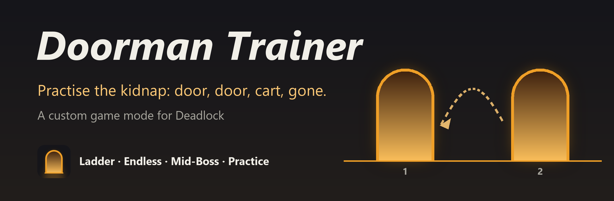
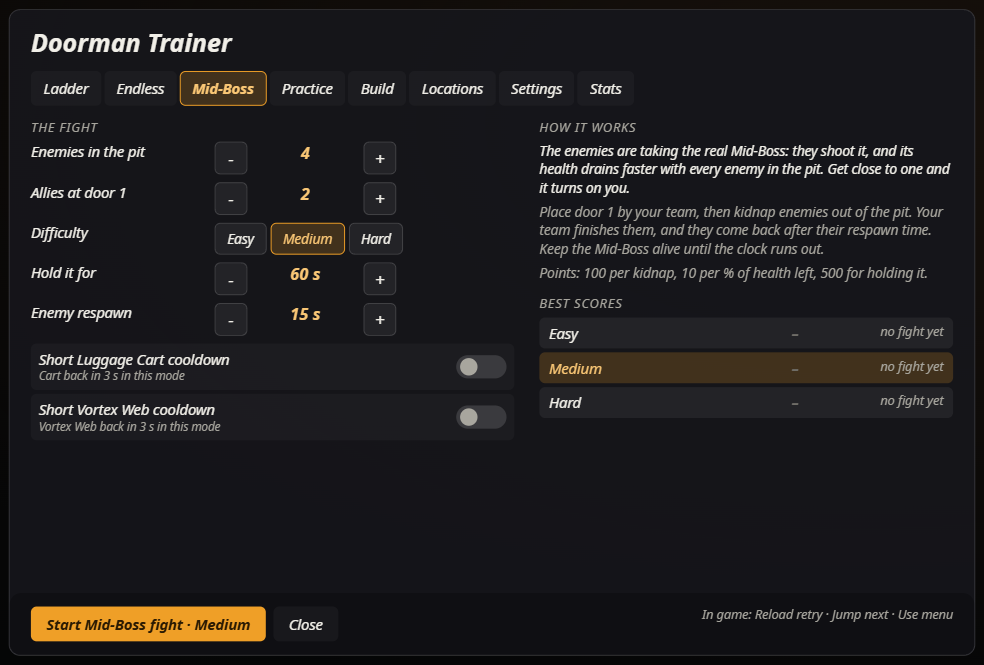

**Get the kidnap into your hands before you need it in a match.**

Doorman Trainer is a custom game mode for Deadlock. Door 1 by your team, door 2
in the fight, Luggage Cart someone through, and go again, as many times as you
like, against bots that walk, dodge and fight back.

Free, and it runs on your own PC.

### [⬇ Download for Windows](https://github.com/BeeeFX/DoormanTrainer/releases/latest/download/DoormanTrainer-win-Setup.exe)

Windows 10 and 11 · Deadlock on Steam · [All releases](https://github.com/BeeeFX/DoormanTrainer/releases)

---

## See it

<table>
<tr>
<td width="34%" valign="top">

<b>A ladder to climb</b>

</td>
<td width="33%" valign="top">

<b>Endless waves, best scores</b>

</td>
<td width="33%" valign="top">

<b>Hold the Mid-Boss</b>

</td>
</tr>
</table>

## What it does

- **Drills the kidnap, start to finish.** Each try puts you at door 1's spot. Place it, and you're dropped
  into the fight to place door 2 and cart someone through. There's no timer on door 1: the fight starts
  the moment it's down.
- **Counts it the moment they come out of your door.** No kill needed. The fight runs on for a few
  seconds so you can watch where they land, or jump in after them.
- **Tells you why you missed.** No door 2, cart missed, dragged them but missed the door: you get the
  reason on screen, and your stats keep track.
- **Chains tries fast.** Tap **Reload** to retry the same setup or **Jump** for the next one. Hold them
  mid-try to restart or skip. No menu in the way.
- **Gives you the build.** Every ability maxed and a Doorman build bought for you, Vortex Web included.
  Change the items before you play if you like.
- **Uses the real map.** Spots by every Guardian and Walker on your side and in the Mid-Boss pit, or
  record your own.
- **Keeps going when your doors close.** If both doors go mid-fight, the clock pauses, you're sent to
  place door 1 again, and you're put back where you stood. You can switch this off.

## Four ways to train

| | |
| --- | --- |
| **Ladder** | 10 levels: a target standing still, then walking, sliding, jumping, all of those at once, a duel, a skirmish, a teamfight, a full fight and the Gauntlet. Pass one (usually 5 kidnaps in your last 8) to unlock the next |
| **Endless** | Kidnap every enemy before the wave clock runs out. More enemies and less time each wave, smarter bots every 6 waves. Points per kidnap, ×2 when one cart brings two. Best score saved per difficulty |
| **Mid-Boss** | The enemy team is taking the real Mid-Boss. Kidnap them out of the pit to your team at door 1 and keep it alive until the clock runs out |
| **Practice** | Your own setup: how many enemies and allies, which heroes, Still, Walk (with jumps, slides and dashes) or Full AI, Easy, Medium or Hard |

## Make it yours

| | |
| --- | --- |
| **Build** | Souls, max all abilities, Doorway range upgrade, starting items |
| **Cooldowns** | Real, short (3 s) or none. Separate switches for a short Luggage Cart or Vortex Web cooldown in each mode |
| **Invincible** | Nothing hurts you. Progress and best scores aren't saved while it's on, or with short cooldowns |
| **Locations** | Pick any mix of spots, look at one before you play, hide a bad one with `/badspot` |
| **Watch after kidnap** | How long the fight runs on after a kidnap (4 s by default) |
| **Stats** | Attempts, kidnaps, streaks, door 2 to cart time, why you missed, rates per location |

## Installing

Download the installer from [Releases](https://github.com/BeeeFX/DoormanTrainer/releases/latest) and run it.
It installs just for you, so Windows won't ask for an administrator password.

> **Windows will warn you the first time.** The installer isn't code-signed. A certificate costs a few
> hundred pounds a year, which is hard to justify for a free tool. Click **More info → Run anyway**.

Then:

1. Double-click **Doorman Trainer** on your desktop or in the Start menu. Steam needs to be running.
2. A small window opens and Deadlock starts straight into the trainer. The menu opens when you spawn.
3. Keep that window open while you train. Close it when you're done.

**To play Deadlock normally, launch it from Steam as usual.** The trainer only runs when you start it
from its own shortcut.

To update, download and run the new installer. Uninstall it like any other app, from Settings › Apps.
Your settings, progress and best scores are kept in `%APPDATA%\modlock\files\doorman-trainer`.

Rather not install anything? Download `DoormanTrainer-win-Portable.zip` from the same release,
unzip it anywhere and run `Play.cmd`.

## Controls

| When | Key | Does |
| --- | --- | --- |
| Result screen | **Reload** (tap) | Retry the same setup |
| Result screen | **Jump** (tap) | Next setup |
| Between tries | **Use** (tap) | Open the menu |
| During a try | **Reload** (hold) | Restart this setup |
| During a try | **Use** (hold) | Skip to the next setup |

`/dt` in chat opens the menu at any time. `/help` lists every command.

## Questions

**Does it change my normal game?** No. Nothing is installed into Deadlock. The trainer runs its own
local server and starts Deadlock into it; launching Deadlock from Steam is exactly as before.

**Do I need an internet connection?** For the first start, and for the in-game menu, which loads through
Modlock's page.

**I clicked "Leave testing" and ended up in the hideout.** That leaves the trainer. Close the trainer's
window and double-click **Doorman Trainer** again, or type `connect 127.0.0.1:27067` in the game console.

**There's no menu or HUD.** Only one trainer (or `modlock` command) can run at a time. Close every
trainer window and start it again.

**A kidnap didn't count.** Turn on Settings → Debug overlay to see what the trainer saw, and
[open an issue](https://github.com/BeeeFX/DoormanTrainer/issues) with the spot and what happened.

**I got put inside a wall or under the map.** Type `/badspot` during that try: the spot is hidden for
good and you move on. Locations can bring hidden spots back.

**Is it really free?** Yes, and the source is here for anyone to read.

## Chat commands

`/dt` menu · `/start` `/stop` `/skip` · `/level 1-10` `/custom` · `/bots` `/allies`
`/difficulty easy|medium|hard` `/behaviour still|walk|fight` · `/souls` `/team 2|3`
`/fastcd real|short|none` `/invincible` `/range` · `/tower <name>` `/fight [name]` `/spots`
`/goto <location> [spot]` `/deltower` `/delfight` `/badspot` · `/probe` `/where` `/units` `/relocate`
`/detect` `/debug` · `/stats` `/resetstats` · `/help`

## For developers

Running it from source, how kidnap detection and the bots work, the project layout and the release
process are in [docs/DEVELOPING.md](docs/DEVELOPING.md).

## Licence

MIT. See [LICENSE](LICENSE). Built with [Modlock](https://github.com/paralin/modlock) (MIT), whose
`modlock.exe` ships in the download and runs the trainer.

Not affiliated with Valve. Deadlock is a trademark of Valve Corporation.
