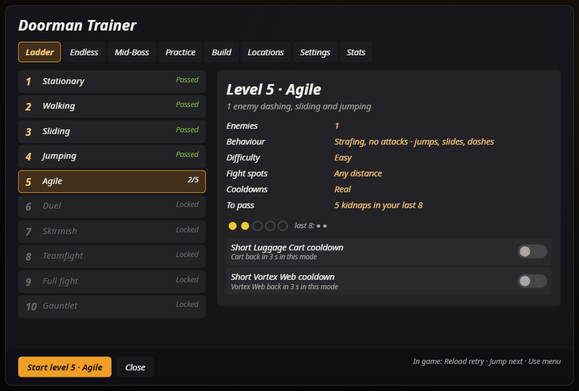
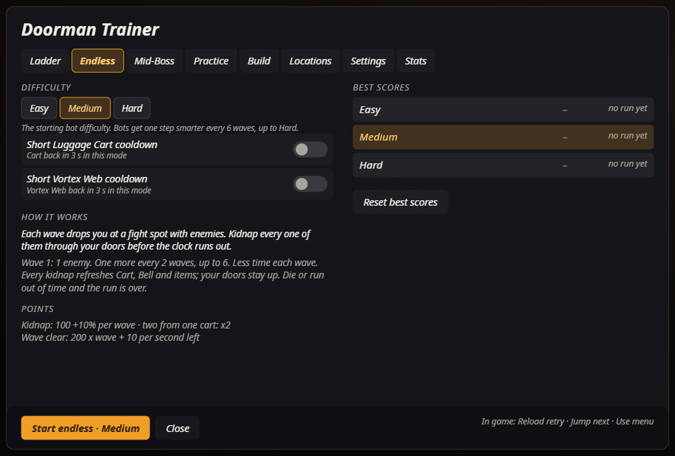

**Nail the Doorman kidnap before you need it in a real match.**

Place your doors, cart them through, and go again, as many times as you like.

### [⬇ Download for Windows](https://github.com/BeeeFX/DoormanTrainer/releases/latest/download/DoormanTrainer-win-Setup.exe)

Free · Windows 10 and 11 · Needs Deadlock on Steam

 

<table>
<tr>
<td width="34%" valign="top">

<b>Climb 10 levels</b>

</td>
<td width="33%" valign="top">

<b>Survive endless waves</b>

</td>
<td width="33%" valign="top">

<b>Hold the Mid-Boss</b>

</td>
</tr>
</table>

## Get started

1. **Install** with the button above. If Windows warns you, click **More info → Run anyway**.
2. **Double-click Doorman Trainer** on your desktop. Deadlock opens straight into the trainer.
3. **Play.** Place door 1, then door 2, then cart someone through. Tap **Reload** to retry or **Jump** for the next one.

Want to play Deadlock normally? Just launch it from Steam like always.

## What's inside

- **Ladder:** from a target standing still to a full teamfight
- **Endless:** clear every wave before the clock runs out
- **Mid-Boss:** kidnap the enemy team out of the pit
- **Practice:** your own setup, from enemies and heroes to how hard they fight

Your build comes ready, Vortex Web included, and the bots walk, dodge and fight back.

Every mode, setting and command is in the [guide](docs/GUIDE.md). Something not right? [Tell us](https://github.com/BeeeFX/DoormanTrainer/issues).

---

MIT licence · Built with [Modlock](https://github.com/paralin/modlock) · For developers: [docs/DEVELOPING.md](docs/DEVELOPING.md) · Not affiliated with Valve. Deadlock is a trademark of Valve Corporation.
